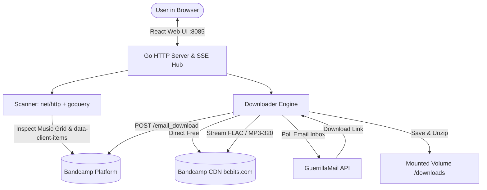

# 🎵 Bandcamp Downloader (Dockerized & Pure Go API)


A modern, high-speed, self-hosted web application for scanning and downloading music from Bandcamp. 

> ⚡ **v2.0 Update**: Completely rewritten to use a **100% pure reverse-engineered Bandcamp HTTP API**. No headless browsers, no Playwright, no Chromium bloat, and no CAPTCHA issues. The resulting Docker image is only **~30 MB** on Alpine Linux and runs smoothly on everything from desktop machines to a **Raspberry Pi 5**.

---

## ✨ Features

- **🚀 Ultra-Fast & Lightweight**: Pure Go HTTP client (`net/http` + `goquery`). Scans large discographies (70+ albums) in ~5–7 seconds.
- **🛡️ 100% Headless-Free**: Direct API interaction. Immune to DOM changes, button selector breakages, and headless browser detection.
- **💰 Intelligent Price Detection**: Automatically categorizes releases into **Free**, **Name Your Price (NYP)**, and **Paid**.
- **📧 Automated $0 / NYP Checkout**: Requests download links via Bandcamp's `/email_download` API and automatically polls disposable email via GuerrillaMail.
- **🎼 Lossless & High-Quality Audio**: Downloads full-quality **FLAC**, **MP3-320**, **WAV**, and other formats directly from Bandcamp's CDN. Automatically extracts album `.zip` archives.
- **⚡ Real-Time Progress**: Live updates streamed to the frontend via **Server-Sent Events (SSE)**.
- **🐳 Docker & Raspberry Pi Ready**: Native multi-stage build running on `alpine` with ARM64 and x86_64 support.

---

## 📖 Release Categories

- **FREE**: Direct free download page available immediately.
- **NYP (Name Your Price)**: Artist allows paying $0. The service automates the checkout form and email retrieval to get the high-quality download link.
- **PAID**: Fixed-price release. Automatically marked so you can skip or inspect it.

---

## 🚀 Quick Start

### Prerequisites

- [Docker](https://docs.docker.com/get-docker/) & [Docker Compose](https://docs.docker.com/compose/install/)

### Installation & Run

1. **Clone the repository:**
   ```bash
   git clone https://github.com/0x800700/bcdl-go.git
   cd bcdl-go
   ```

2. **Start the container:**
   ```bash
   docker compose up -d --build
   ```

3. **Open the Web UI:**
   Navigate to:
   👉 **[http://localhost:8085](http://localhost:8085)** *(or `http://<your-server-ip>:8085`)*

4. **Paste an artist URL** (e.g. `https://artist.bandcamp.com`), click **Scan Artist**, pick your releases, and hit **Download Selected**!

---

## ⚙️ Configuration

### Custom Download Folder

By default, downloads are saved to `./downloads` on your host machine. To save to an external drive, NAS, or custom directory, simply edit `docker-compose.yml`:

```yaml
services:
  bcdl:
    volumes:
      # Change the host path (before the colon) to your preferred folder:
      - /path/to/your/music/folder:/downloads
```

Apply changes instantly with:
```bash
docker compose up -d
```

### Port

The service listens on port `8085` by default (`8085:8080`). To change the port:
```yaml
    ports:
      - "8080:8080" # Maps port 8080 on the host to container
```

---

## 🏗️ Architecture



- **Frontend**: React 18, TypeScript, Tailwind CSS, Lucide Icons, Vite.
- **Backend**: Go (standard `net/http`, `goquery`, SSE EventBroker).
- **Container**: Multi-stage Docker build (`node:20-alpine` ➔ `golang:alpine` ➔ `alpine:3.21`), total runtime footprint ~30 MB RAM / ~30 MB disk.

---

## 📄 License

This project is licensed under the MIT License - see the [LICENSE](LICENSE) file for details.

---

**Good enough is good enough by ProBably Works**
